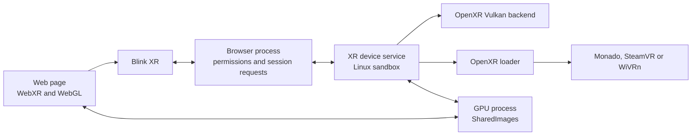

Linux Chromium already had WebXR APIs in Blink, but lacked support for
`immersive-vr` on Linux. My main contribution was getting WebXR over OpenXR
working again on Linux and upstreaming the backend and sandbox. The path
connects Chromium to runtimes such as Monado, SteamVR, and WiVRn.

Each runtime handles its own headset, controllers, and compositor.

This is a personal hobby project, not an official Chromium effort. I work on it
for fun. I send changes upstream when there is a concrete need.

This is the first milestone: a basic version, not a finished product. I plan
to keep testing it with more runtimes, hardware, and distributions.

## How it works

An immersive session uses several Chromium processes:

- **Blink and the browser process** handle WebXR API calls, permissions and
  session requests.
- **The XR device service** owns the OpenXR instance and session, Vulkan device
  and frame loop. The OpenXR loader connects it to the active runtime.
- **The GPU process** manages the SharedImages used to transfer rendered frames.

The page talks to the XR service through Chromium's Mojo interfaces, not
directly to the runtime.

For each frame, the service waits for the runtime, locates the headset views,
and sends their poses to the page. After drawing, the page submits the frame;
the service copies its images into OpenXR swapchains and submits it to the
runtime.

## Sandbox

The XR device service loads the runtime and graphics drivers, accesses the GPU,
and connects to the runtime's compositor socket inside Chromium's Linux
sandbox:

- **Before lockdown:** Chromium reads the active runtime manifest and prepares
  the runtime and graphics-library dependencies.
- **After lockdown:** Seccomp and the file broker remain active. The broker
  grants access only to the manifest, libraries, Vulkan driver, GPU devices
  and runtime data the service needs.
- **For runtime IPC:** The service uses brokered Unix-domain sockets to reach
  the runtime. It does not enter a network namespace, which would break those
  connections.

Socket and file access depends on the runtime. Monado uses
`monado_comp_ipc`; WiVRn uses `wivrn/comp_ipc`. SteamVR also needs shared memory
and log access.

Some runtime manifests use a relative library path containing `..`, which the
file broker rejects. Chromium loads the library before sandboxing, then uses
`RTLD_NOLOAD` to alias the loader's path to that already-loaded library. This
lets the loader use it without reopening the rejected path. This fix is part of
the [WiVRn sandbox change](https://chromium-review.googlesource.com/c/chromium/src/+/8696747),
merged on November 4, 2026.

## Chromium versions and support

| Chromium milestone | Linux WebXR/OpenXR support |
| --- | --- |
| M152 | Fixes two OpenXR session teardown crashes. |
| M154 | Adds the Linux OpenXR backend; runtime support is not enabled yet. |
| M156 | Runs the XR device service in the Linux sandbox. |
| M157 | Enables end-to-end WebXR over OpenXR and frame synchronization. Turn it on with `--enable-features=OpenXR`; it is off by default. |
| M158 | Adds WebXR Layers support. |
| M159 | Adds WiVRn sandbox support. Chromium `159.0.8135.0` was tested in Flatpak and native builds. |

Flatpak can sandbox Chromium, but this custom package lacks Flathub's Chromium
sandbox patches, so it only uses Flatpak's app sandbox. The native build runs
the XR service in Chromium's sandbox.

## Upstream work and what's next

These changes have merged: the [Linux backend](https://chromium-review.googlesource.com/c/chromium/src/+/8210979),
[runtime enablement](https://chromium-review.googlesource.com/c/chromium/src/+/8132979),
[XR sandbox](https://chromium-review.googlesource.com/c/chromium/src/+/8441736),
[frame synchronization](https://chromium-review.googlesource.com/c/chromium/src/+/8471692),
[WebXR Layers](https://chromium-review.googlesource.com/c/chromium/src/+/8471693), and
[WiVRn sandbox support](https://chromium-review.googlesource.com/c/chromium/src/+/8696747).
OpenXR still needs the `OpenXR` feature enabled; [enabling it by default on
Linux](https://chromium-review.googlesource.com/c/chromium/src/+/8641285) is
under review.

### Why upstreaming takes time

My local session is one test. The changes also have to fit Chromium's
architecture and security rules and pass its builders.

#### Landing, reverting and relanding

The first [Linux OpenXR backend](https://chromium-review.googlesource.com/c/chromium/src/+/8121052)
was reverted after failing the Linux CFI bot's indirect-call checks. It was
[relanded](https://chromium-review.googlesource.com/c/chromium/src/+/8210979)
after those failures were fixed.

The first [XR sandbox change](https://chromium-review.googlesource.com/c/chromium/src/+/8127854)
was reverted after breaking a Cast build. It was
[relanded](https://chromium-review.googlesource.com/c/chromium/src/+/8441736)
after the build issue was fixed.

#### Earlier Linux browser attempts

Before my first `chromium-webxr-linux` commit in April 2026, the
[mrxz/webxr-linux project](https://github.com/mrxz/webxr-linux) collected two
Linux experiments: a Chromium 117 patch using OpenXR, and Firefox patches using
OpenVR on Linux/X11. The Chromium patch required `--no-sandbox`; the Firefox
author described that work as a hack rather than a full implementation. These
were separate attempts from the implementation I later got working and
upstreamed to Chromium.

#### Architecture and security review

Reviewers asked me to keep platform-specific code scoped, remove redundant
checks, and drop a swapchain-format option without a clear need. Sandbox review
narrowed file and socket access. CFI review asked for narrowly scoped
suppressions.

#### The test matrix is broader than a headset

The changes touch Blink, the XR service, Vulkan, browser UI, and sandbox
policy. CFI and Cast builders found issues that my Monado session did not.
