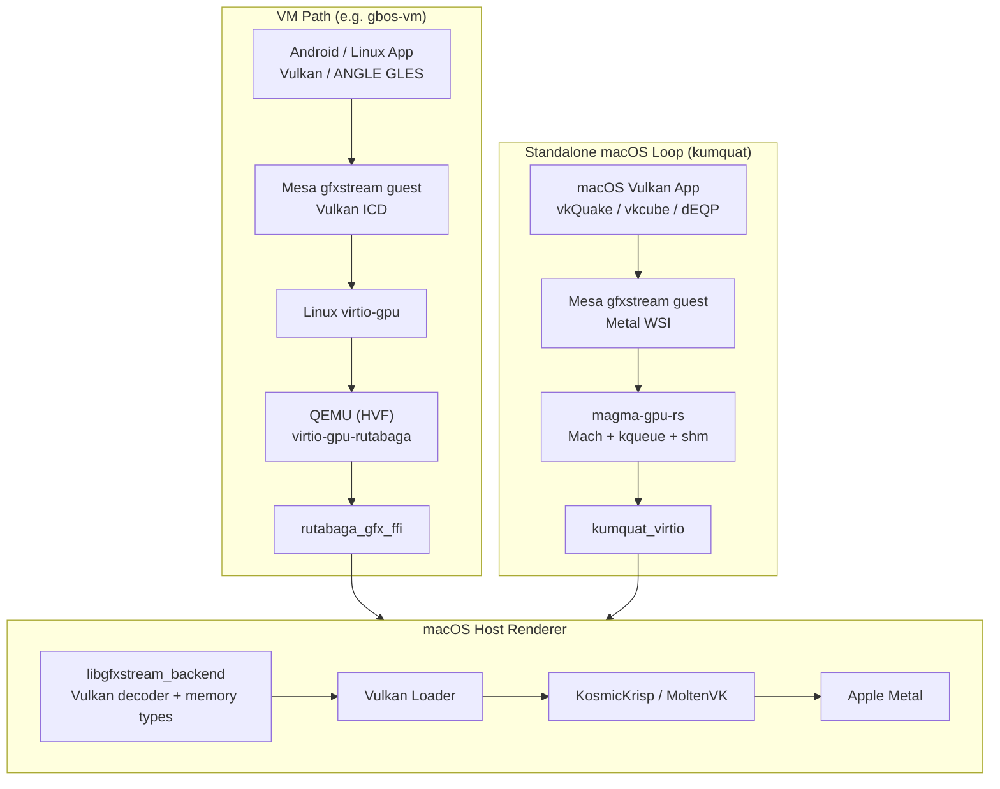
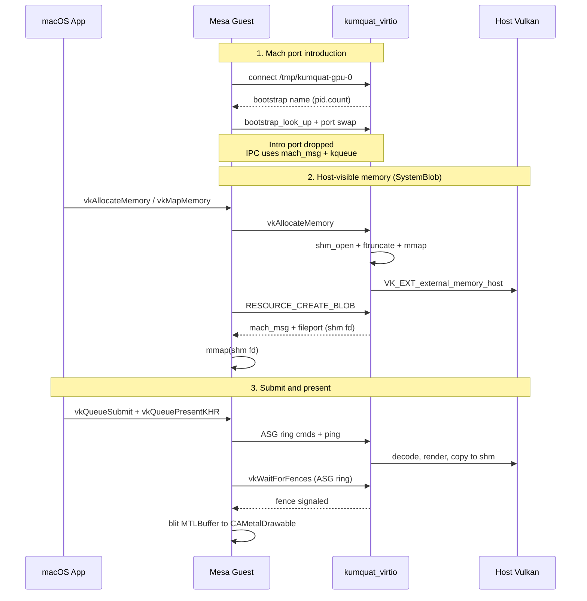
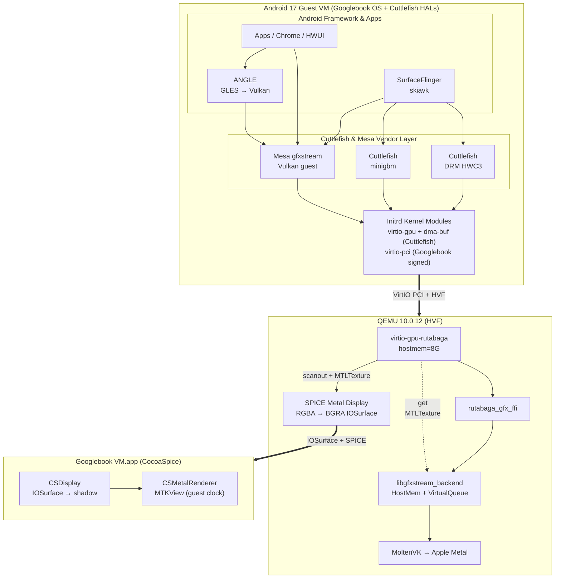
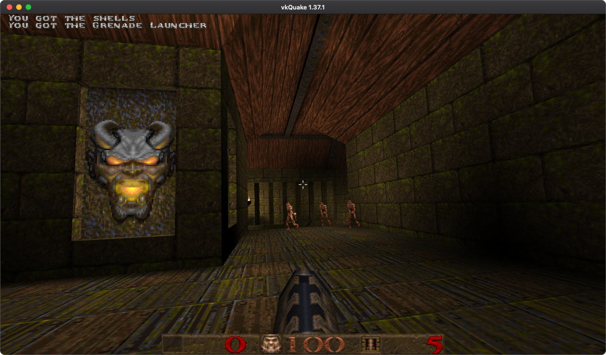
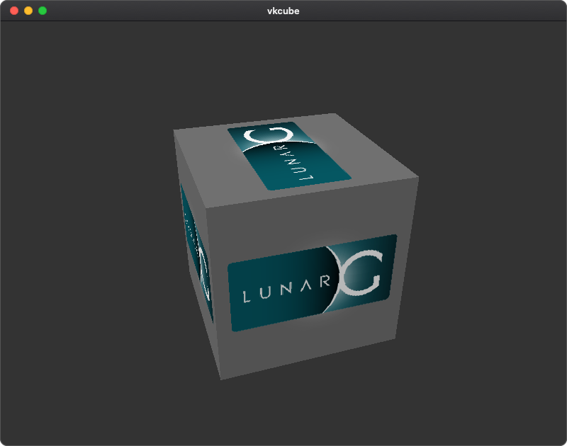
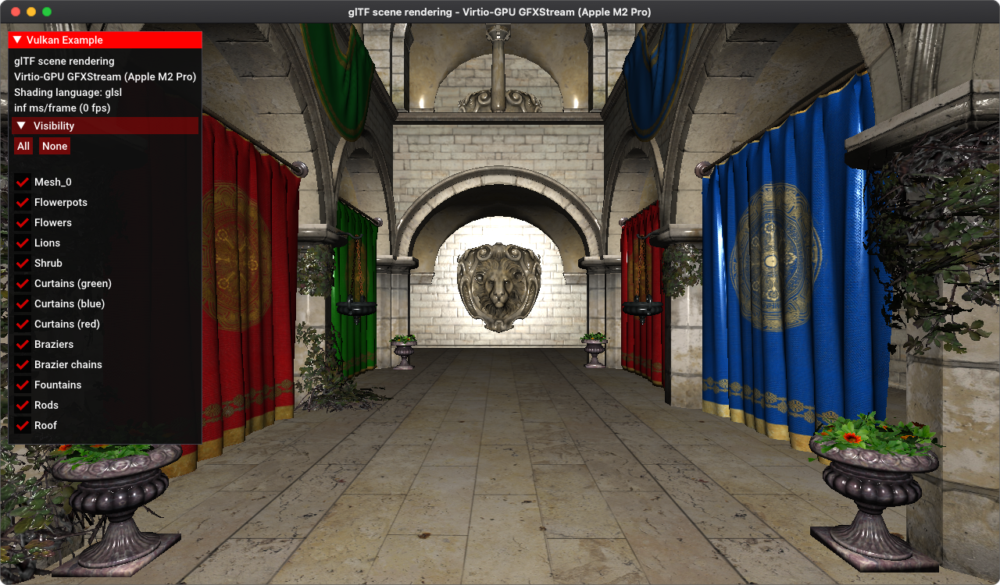
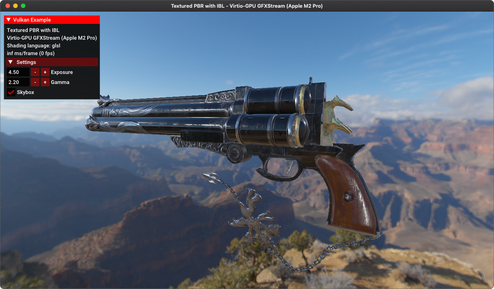
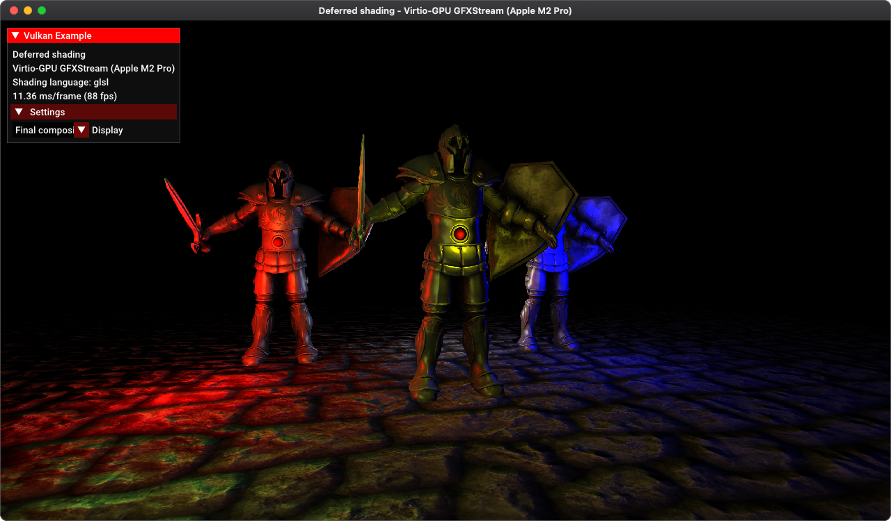
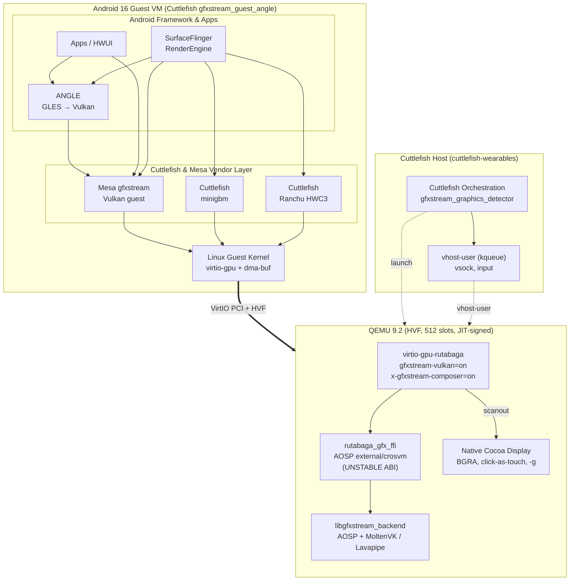
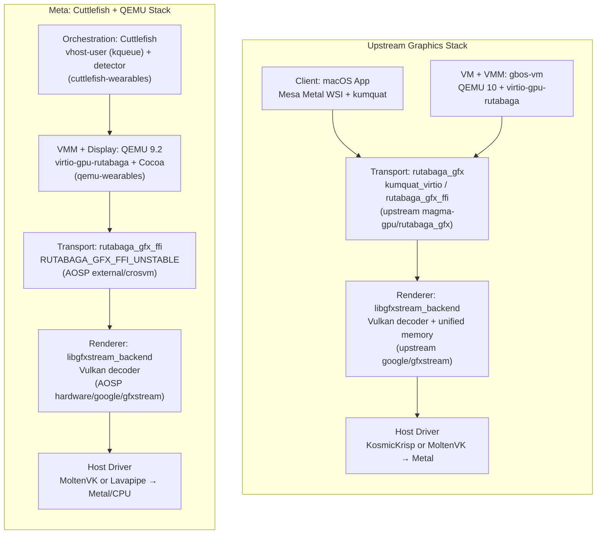

`gfxstream` forwards guest Vulkan calls to a host GPU. On Linux, it relies on `dma-buf`, `memfd`, `eventfd`, `epoll`, `SOCK_SEQPACKET`, and native Vulkan drivers.

macOS already had several pieces in place. `google/gfxstream` included macOS host code from Android Emulator and earlier standalone build work ([PR #109](https://github.com/google/gfxstream/pull/109), [PR #151](https://github.com/google/gfxstream/pull/151)). `rutabaga_gfx` compiled its FFI and `gfxstream` bindings on macOS, and Mesa had Metal WSI and [KosmicKrisp](https://docs.mesa3d.org/drivers/kosmickrisp.html).

I have worked across `google/gfxstream`, `magma-gpu/rutabaga_gfx`, and Mesa to get upstream `libgfxstream_backend` building and running on Apple Silicon over KosmicKrisp or [MoltenVK](https://github.com/KhronosGroup/MoltenVK), with macOS CI and unified-memory support. That lets VMs on macOS such as `gbos-vm` use `rutabaga_gfx`'s `gfxstream` backend. I have also ported `kumquat` (a virtio-gpu IPC server) and Mesa's `gfxstream` Vulkan guest to macOS to test and debug the guest-to-host protocol without booting a VM.

## How it works on macOS

VM guests and standalone macOS apps share the same `libgfxstream_backend` host renderer:



- **VM path:** A Linux or Android guest talks to `virtio-gpu`. QEMU's `virtio-gpu-rutabaga` device calls `rutabaga_gfx_ffi`, which sends commands straight to `libgfxstream_backend` without `virglrenderer`.
- **Standalone macOS loop (`kumquat`):** macOS has no kernel `virtio-gpu` driver, so Mesa's `gfxstream` guest defaults to `kumquat`. It talks to a local `kumquat_virtio` server over Mach ports and POSIX shared memory, then presents through Metal WSI.

## Upstream changes

- **`google/gfxstream`:** `libgfxstream_backend` builds on Apple Silicon with Bazel, CMake, and Meson, and macOS CI checks all three. The Bazel workspace can also build `kumquat_virtio` against it, and shared memory uses POSIX `shm_open` instead of `memfd`. On unified-memory drivers such as KosmicKrisp, `gfxstream` adds a guest-only `DEVICE_LOCAL` memory type so tiled images do not bind to imported host pointers.
- **`magma-gpu-rs` and `rutabaga_gfx`:** A Darwin backend replaces Linux `SOCK_SEQPACKET`, `eventfd`, and `epoll` with Mach ports and `kqueue`. Because Metal cannot export `VkDeviceMemory` as a `dma-buf` fd, host-visible memory uses `SystemBlob`: the host imports `shm_open` memory with `VK_EXT_external_memory_host` and passes the fd to the guest.
- **Mesa:** The macOS `gfxstream` Vulkan guest (`libvulkan_gfxstream.dylib`) defaults to `kumquat` and sends commands over the AddressSpaceGraphics (ASG) ring buffer. For presentation through Metal WSI, the host copies each swapchain frame into shared memory and the guest blits it to a `CAMetalDrawable`.



## Examples

### Googlebook VM (`gbos-vm`)

[Rarasinhoo/gbos-vm](https://github.com/Rarasinhoo/gbos-vm/tree/main) runs unmodified Android 17 Googlebook OS system partitions on Apple Silicon at up to 120 Hz. The guest uses Cuttlefish kernel modules, vendor HALs, and a standalone build of AOSP Mesa's Android `gfxstream` Vulkan driver (`vulkan.ranchu.so`, with a small patch).

The host runs UTM's QEMU 10.0.12 (HVF, built as a shared library) with upstream `rutabaga_gfx_ffi` and `libgfxstream_backend` over MoltenVK, enabling `VulkanAllocateHostMemory` and `VulkanVirtualQueue`, plus `gbos-vm`'s own zero-copy Metal scanout patch.

The full `gbos-vm` pipeline looks like this:



### `vkQuake`

On macOS, [vkQuake](https://github.com/Novum/vkQuake) used to link MoltenVK directly, so `VK_DRIVER_FILES` could not select another driver. [Novum/vkQuake#1041](https://github.com/Novum/vkQuake/pull/1041) added a `-Duse_vulkan_loader=enabled` Meson option to link the Vulkan loader instead.

Running the shareware `pak0.pak` through `kumquat_virtio` in a 1280×720 window (2560×1440 backing pixels at 2×), `vkQuake` reports `Virtio-GPU GFXStream (Apple M2 Pro)`. On a 120 Hz MacBook Pro display, `timedemo demo1` (969 frames) runs at about 118 fps on KosmicKrisp and 117–118 fps on MoltenVK. Native runs hit the same 118–120 fps limit because presentation is capped by the display refresh rate.



### `vkcube`, `dEQP-VK`, and Sascha Willems Vulkan samples

`vkcube` works on both host drivers. The `dEQP-VK` smoke and Metal WSI subset (`dEQP-VK.api.smoke.*`, `dEQP-VK.wsi.metal.surface.*`, and basic `swapchain` create, acquire, and render cases) has zero failures: 32 of 45 pass on KosmicKrisp and 33 of 45 on MoltenVK, while the rest report not supported. Before the extension update below, I also ran 99 of [Sascha Willems' Vulkan samples](https://github.com/SaschaWillems/Vulkan) (300 frames each) natively and through `gfxstream`:

| Mode | Passing (of 99) |
| --- | --- |
| Native KosmicKrisp | 74 |
| `gfxstream` → KosmicKrisp | 64 |
| Native MoltenVK | 73 |
| `gfxstream` → MoltenVK | 64 |

The 25–26 native failures come from features Metal lacks, such as ray tracing and mesh shaders. Most of the extra `gfxstream` failures came from extension filtering, since the host only advertises extensions its generated decoder knows. Mesa [!44894](https://gitlab.freedesktop.org/mesa/mesa/-/merge_requests/44894) exposed six KHR extensions that both KosmicKrisp and MoltenVK already support: `VK_KHR_timeline_semaphore`, `VK_KHR_push_descriptor`, `VK_KHR_depth_stencil_resolve`, `VK_KHR_dynamic_rendering_local_read`, `VK_KHR_device_group_creation`, and `VK_KHR_device_group`. With the matching host decoder update (now in `google/gfxstream`), KosmicKrisp passes rose from 64 to 70 of 99.

Captured on an Apple M2 Pro through `kumquat_virtio` and KosmicKrisp:









## Running it locally

Build `kumquat_virtio` from `google/gfxstream` and the guest and host drivers from Mesa. KosmicKrisp needs Homebrew `llvm`, `spirv-llvm-translator`, and `spirv-tools`, with keg-only `llvm` on `PATH`; drop `kosmickrisp` from `-Dvulkan-drivers` if you use MoltenVK on the host:

```bash
# In google/gfxstream
bazel build @rutabaga//:rutabaga_gfx_kumquat_server

# In mesa
PATH="$(brew --prefix llvm)/bin:$PATH" \
meson setup build \
  -Dvulkan-drivers=gfxstream,kosmickrisp \
  -Dgallium-drivers= \
  -Dopengl=false \
  -Dvirtgpu_kumquat=true \
  -Dplatforms=macos
ninja -C build
```

Then start the server and a client:

```bash
# Terminal 1: host kumquat server on KosmicKrisp (or MoltenVK)
DYLD_FALLBACK_LIBRARY_PATH=/opt/homebrew/lib \
VK_DRIVER_FILES=/path/to/mesa/build/src/kosmickrisp/vulkan/kosmickrisp_mesa_devenv_icd.aarch64.json \
  bazel-bin/external/+git_repository+rutabaga/kumquat_virtio

# Terminal 2: client via the gfxstream guest ICD
# (Mesa >= c01f84441bc enables kumquat by default on macOS; older builds need VIRTGPU_KUMQUAT=1)
VK_DRIVER_FILES=/path/to/mesa/build/src/gfxstream/guest/vulkan/gfxstream_vk_devenv_icd.aarch64.json \
  vulkaninfo --summary
```

Use `DYLD_FALLBACK_LIBRARY_PATH=/opt/homebrew/lib` instead of `DYLD_LIBRARY_PATH`. `DYLD_LIBRARY_PATH` overrides even absolute `library_path` entries inside ICD manifests, while `DYLD_FALLBACK_LIBRARY_PATH` only applies to bare names like `libvulkan.dylib`. When selecting MoltenVK with `VK_DRIVER_FILES`, also set `MVK_CONFIG_USE_METAL_ARGUMENT_BUFFERS=0`. Otherwise `gfxstream` only sets it internally under `ANDROID_EMU_VK_ICD=moltenvk`.

## Related work: Meta's Cuttlefish on Mac

On November 13, 2026, Meta Reality Labs published [Cuttlefish on Mac](https://engineering.fb.com/2026/11/13/android/cuttlefish-on-mac/). It ports Cuttlefish's QEMU backend for Android 16 to Apple Silicon using a `qemu-wearables` fork and a `cuttlefish-wearables` AOSP patch bundle.

Most of their changes are in the VMM and Cuttlefish host tools. They enabled QEMU's `vhost-user` frontends, `libvhost-user`, and `contrib/vhost-user-blk` on macOS. For Cuttlefish daemons such as `vhost-device-vsock`, they added a Rust `epoll`-over-`kqueue` shim and C++ `kqueue` replacements. In QEMU 9.2, they raised HVF memory-region slots from 32 to 512 ([`92be519d5f97`](https://github.com/facebookincubator/qemu-wearables/commit/92be519d5f97)), updated the Cocoa display (BGRA, click-as-touch, `-g` geometry, window resize), and added JIT code signing.

For graphics, Meta built on AOSP Android 16's `external/crosvm` and `hardware/google/gfxstream`, where `gfxstream` already had Apple CMake support. [crosvm/0001](https://github.com/facebookincubator/cuttlefish-wearables/blob/main/patches/external/crosvm/0001-Fix-rutabaga-gfx-FFI-Path-build-errors.patch) fixed a Cargo build error in `rutabaga_gfx_ffi`, [gfxstream/0001](https://github.com/facebookincubator/cuttlefish-wearables/blob/main/patches/hardware/google/gfxstream/0001-Add-graphics-detection-to-mac-and-verbose-logging-fl.patch) ported `gfxstream_graphics_detector` by probing `/opt/homebrew/lib/libMoltenVK.dylib`, and [mesa3d/0001](https://github.com/facebookincubator/cuttlefish-wearables/blob/main/patches/external/mesa3d/0001-make-mesa3d-darwin-compatible.patch) got Lavapipe compiling on macOS. In `qemu-wearables`, [`605dafded0dc`](https://github.com/facebookincubator/qemu-wearables/commit/605dafded0dc) defined `RUTABAGA_GFX_FFI_UNSTABLE` in `virtio-gpu-rutabaga.c` to match the Rust FFI's GPU fence fields. [cuttlefish/0028](https://github.com/facebookincubator/cuttlefish-wearables/blob/main/patches/device/google/cuttlefish/0028-Enable-MoltenVK-graphics-with-rutabaga.patch) removed macOS guards so Cuttlefish uses AOSP's `virtio-gpu-rutabaga` config (`hostmem=256M`, `x-gfxstream-composer=on`) and points `VK_DRIVER_FILES` at `MoltenVK_icd.json` or `lvp_icd.aarch64.json`.

`cuttlefish-wearables` documents how to build the Soong host package (`cvd-host_package.tar.gz`) and points to `qemu-wearables`, a publish-only mirror without a standalone macOS build script for QEMU and `rutabaga_gfx_ffi`.

Here is how Meta's stack fits together:



## Stack comparison

All three setups place `libgfxstream_backend` behind `rutabaga_gfx` to decode guest Vulkan calls for KosmicKrisp or MoltenVK on Metal, or Lavapipe on CPU. I have been working on the upstream graphics and transport repos (`google/gfxstream`, `magma-gpu/rutabaga_gfx`, and Mesa) so both VMs and VM-free tests can run on macOS. Meta builds on AOSP's `external/crosvm` and `hardware/google/gfxstream` instead, focusing on Cuttlefish orchestration and QEMU 9.2.



| Stack | VMM / Transport | `rutabaga_gfx` source | Host `gfxstream` and Vulkan ICD | Display path |
| --- | --- | --- | --- | --- |
| Standalone macOS loop (`kumquat`) | No VM (`kumquat` over Mach ports + `shm_open`) | Standalone `magma-gpu/rutabaga_gfx` (`kumquat_virtio` → `gfxstream`) | Upstream `google/gfxstream` + KosmicKrisp or MoltenVK | Guest Mesa Metal WSI (`CAMetalDrawable`) |
| `gbos-vm` (Android 17) | UTM QEMU 10.0.12 (HVF), `virtio-gpu-rutabaga` (`hostmem=8G`, no `virglrenderer`) | Standalone `magma-gpu/rutabaga_gfx` (`rutabaga_gfx_ffi`, `--features gfxstream`) | `google/gfxstream` (+ scanout patch) + MoltenVK | Zero-copy `MTLTexture` → SPICE Metal display → `IOSurface` → CocoaSpice `MTKView` |
| Meta Cuttlefish on Mac | QEMU 9.2 (HVF, 512 slots), `virtio-gpu-rutabaga` (`hostmem=256M`, `x-gfxstream-composer=on`) | AOSP `external/crosvm` (`rutabaga_gfx_ffi`, `RUTABAGA_GFX_FFI_UNSTABLE`) | AOSP `hardware/google/gfxstream` + MoltenVK or Lavapipe | QEMU native Cocoa display (BGRA) |
